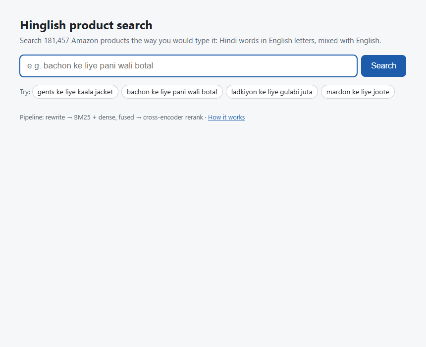
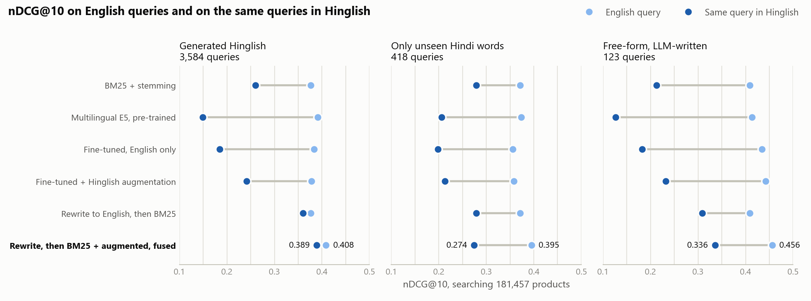

# Hinglish Product Search

Product search for queries typed in **Hinglish**, romanised Hindi mixed with English
(`stocking stuffers bado ke liye 10 se kam` for *stocking stuffers for adults under 10*),
built and evaluated on Amazon's public ESCI shopping dataset.



*The served pipeline on a laptop CPU: known Hindi words are rewritten to English ("searched as"), BM25 and the fine-tuned retriever are fused, and a cross-encoder reranks the top 50.*

Code-mixed queries are common in Indian e-commerce: Flipkart reports that around 21% of
the queries on its platform are code-mixed Hinglish ([Kulkarni et al., 2022](https://arxiv.org/abs/2208.03713)).
Spelling is not standardised (`safed` / `sufed`, `botal` / `bottal`) and Hindi word order
differs from English (`ladkon ke liye ghadi` is literally *boys for watch*). A retriever
trained on English queries has never seen either. This project measures how much that
costs, and what fixes it, without any real Hinglish training data.

**What is in the repo**

1. **A Hinglish query generator** with grammar rules, a 185-word lexicon with spelling
   variants, and catalogue brand protection. 25 Hindi word families are held out of
   training, so the test set can include Hindi words the model never saw.
2. **An evaluation that compares like with like**: every Hinglish query set is paired with
   the same queries in English, a separate set changes *only* unseen Hindi words, and
   123 free-form Hinglish queries were written without the generator.
3. **Thirteen retrieval configurations**, from BM25 to a fine-tuned two-tower model, a
   "translate back to English" baseline and hybrid lexical + dense retrieval, plus three
   rerankers, with paired bootstrap intervals on every comparison that matters.
4. **A served pipeline**: FastAPI search API and demo page, CPU latency per stage, and an
   int8-quantised reranker.

## Results

<picture>
  <source media="(prefers-color-scheme: dark)" srcset="results/hinglish_gap_dark.png">
  
</picture>

Each row: nDCG@10 on the English queries (light) and on the same queries in Hinglish
(dark), searching all 181,457 products, unjudged products counted as irrelevant. The gap
between the dots is what Hinglish costs that system.

### What the numbers say

Every difference below is paired over the same queries, with a bootstrap 95% interval in
brackets (all of them: [results/report.md](results/report.md)).

1. **Hinglish halves an English-trained retriever.** The fine-tuned English model drops
   from 0.383 to 0.185 nDCG@10 on generated Hinglish and from 0.434 to 0.182 on
   free-form Hinglish. Multilingual pre-training does not rescue it: multilingual E5 is
   the strongest pre-trained model on English (0.412) and among the weakest on Hinglish
   (0.149 generated, 0.127 free-form). Romanised Hindi is not the Devanagari Hindi it
   learned.
2. **Augmentation recovers part of the drop, at no cost in English.** Same model, same
   data, augmentation on versus off: +0.056 on generated Hinglish [+0.052, +0.061], +0.050
   on free-form [+0.027, +0.074], +0.015 on held-out Hindi words [+0.007, +0.023], and
   −0.001 on English [−0.002, +0.001].
3. **A dictionary rewrite recovers more, for less.** Mapping known Hindi words and grammar
   back to English before searching beats augmentation even on the free-form set, which
   it was not built from: the English model after the rewrite scores 0.045 above the
   augmented model there [+0.007, +0.084].
4. **Fusing BM25 with the dense model is the largest gain, in English too.** Reciprocal
   rank fusion of stemmed BM25 and the augmented model adds +0.034 on English
   [+0.030, +0.037] and +0.045 on generated Hinglish [+0.040, +0.050] over the model alone.
   With the rewrite in front, the fused pipeline beats rewrite + BM25 by +0.029 on
   generated Hinglish [+0.024, +0.033] and by +0.027 on free-form [−0.002, +0.056], the
   latter not significant at 123 queries.
5. **Inside that pipeline, augmentation stops mattering.** With the rewrite and BM25 in
   front, the augmented and English-only models are within 0.01 of each other: −0.003 on
   English and −0.004 on generated Hinglish (significant, and tiny), +0.005 on unseen
   words and +0.010 on free-form (neither significant). The rewrite already handles the
   words augmentation teaches. Augmentation is worth +0.05 to a dense-only system, and
   about nothing to this one.
6. **Unseen Hindi words remain unsolved.** On queries whose only Hindi words were held out
   of training, the best pipeline scores 0.274 against 0.395 for the same queries in
   English, no better than stemmed BM25 alone (−0.005 [−0.018, +0.009]), and every
   dense model alone does worse than BM25. BM25 ignores a word it does not know; a dense
   model has to embed it. The error analysis below finds the same in the free-form set.
7. **Fine-tuning the reranker pays off, and the headline metric hides it.** On the fused
   pipeline the fine-tuned reranker adds +0.027 on English [+0.018, +0.035] and +0.020 on
   generated Hinglish [+0.007, +0.033] (2,000-query subset). Against the off-the-shelf MS
   MARCO cross-encoder it even looks worse on Hinglish nDCG@10 (−0.011
   [−0.021, −0.001]), yet on ESCI's judged lists it is better by +0.025 on English
   [+0.020, +0.031] and +0.017 on Hinglish [+0.008, +0.026], while MS MARCO ranks the
   judged lists worse than no reranker at all (−0.012 [−0.019, −0.005]). Its nDCG@10
   comes from pulling judged products into the top 10 (judged@10 0.485 against 0.452 on
   English), not from ordering products better. The same convention explains the drop
   after reranking free-form queries: −0.030 nDCG@10, but −0.006 with unjudged products
   removed, neither significant.
8. **int8 is nearly free.** The int8 reranker costs 0.004 nDCG@10 [−0.008, +0.000] and
   reranks in about half the time (328 ms against 638 ms p50). Reranking 50 products is
   most of the latency; fusing in BM25 adds about 17 ms to retrieval.

### Retrieval, full test set

| Model | English (8,955) | Hinglish (3,584) | same, in English (3,584) | Unseen words only (418) | same, in English (418) |
|---|---|---|---|---|---|
| BM25 | 0.371 | 0.242 | 0.343 | 0.262 | 0.339 |
| BM25 + plural stemming | 0.396 | 0.260 | 0.376 | 0.279 | 0.371 |
| Dictionary rewrite to English, then BM25 + stemming | 0.396 | 0.360 | 0.376 | 0.279 | 0.371 |
| MiniLM-L6, pre-trained | 0.350 | 0.159 | 0.325 | 0.179 | 0.310 |
| Multilingual MiniLM-L12 (paraphrase), pre-trained | 0.220 | 0.087 | 0.223 | 0.102 | 0.209 |
| Multilingual E5-small (retrieval), pre-trained | 0.412 | 0.149 | 0.391 | 0.206 | 0.373 |
| MiniLM-L6 fine-tuned on English ESCI | 0.397 | 0.185 | 0.383 | 0.198 | 0.356 |
| Dictionary rewrite, then the English fine-tuned model | 0.397 | 0.355 | 0.383 | 0.198 | 0.356 |
| MiniLM-L6 fine-tuned + Hinglish augmentation | 0.396 | 0.241 | 0.378 | 0.213 | 0.358 |
| Dictionary rewrite, then the augmented model | 0.396 | 0.353 | 0.378 | 0.213 | 0.358 |
| Stemmed BM25 + augmented model, rank fusion | 0.430 | 0.287 | 0.408 | 0.274 | 0.395 |
| Rewrite, then stemmed BM25 + English fine-tuned model, fused | 0.433 | 0.393 | 0.414 | 0.269 | 0.397 |
| **Rewrite, then stemmed BM25 + augmented model, fused** | 0.430 | 0.389 | 0.408 | 0.274 | 0.395 |

### Free-form Hinglish, not made by the generator

The rewrite, the fusion and the reranker in the last row are all in the served path.

| Model | Free-form Hinglish (123) | same, in English (123) |
|---|---|---|
| BM25 | 0.201 | 0.383 |
| BM25 + plural stemming | 0.212 | 0.409 |
| Dictionary rewrite to English, then BM25 + stemming | 0.309 | 0.409 |
| MiniLM-L6, pre-trained | 0.165 | 0.383 |
| Multilingual MiniLM-L12 (paraphrase), pre-trained | 0.112 | 0.248 |
| Multilingual E5-small (retrieval), pre-trained | 0.127 | 0.414 |
| MiniLM-L6 fine-tuned on English ESCI | 0.182 | 0.434 |
| Dictionary rewrite, then the English fine-tuned model | 0.277 | 0.434 |
| MiniLM-L6 fine-tuned + Hinglish augmentation | 0.232 | 0.442 |
| Dictionary rewrite, then the augmented model | 0.304 | 0.442 |
| Stemmed BM25 + augmented model, rank fusion | 0.261 | 0.456 |
| Rewrite, then stemmed BM25 + English fine-tuned model, fused | 0.326 | 0.459 |
| **Rewrite, then stemmed BM25 + augmented model, fused** | 0.336 | 0.456 |
| Augmented model + fine-tuned reranker | 0.237 | 0.470 |
| **Rewrite, fused retrieval, fine-tuned reranker** | 0.306 | 0.467 |

### Reranking, 2,000-query test subset

The last column re-orders only the products judged for each query (ESCI Task 1).

| Model | English (2,000) | Hinglish (798) | same, in English (798) | Unseen words only (105) | Judged list, Hinglish (798) |
|---|---|---|---|---|---|
| Augmented retriever | 0.397 | 0.245 | 0.389 | 0.222 | 0.709 |
| + pre-trained cross-encoder (MS MARCO) | 0.444 | 0.282 | 0.435 | 0.283 | 0.700 |
| + fine-tuned cross-encoder (+ Hinglish augmentation) | 0.444 | 0.272 | 0.441 | 0.253 | 0.717 |
| + fine-tuned cross-encoder, int8 | 0.439 | 0.268 | 0.436 | 0.250 | 0.716 |
| Rewrite, then stemmed BM25 + augmented retriever, fused | 0.430 | 0.393 | 0.417 | 0.274 | 0.729 |
| **+ fine-tuned cross-encoder** | 0.456 | 0.413 | 0.444 | 0.272 | 0.749 |
| + fine-tuned cross-encoder, int8 (the served path) | 0.453 | 0.409 | 0.439 | 0.279 | 0.746 |

### Latency

One query at a time on the CPU of a 4-core laptop (i7-1195G7), 300 Hinglish queries. The
four paths run in one process, interleaved query by query, so any background load slows
them alike.

| Path | Encode p50 | Search p50 | Rerank p50 | Total p50 | Total p95 |
|---|---|---|---|---|---|
| Retriever only | 14 ms | 8 ms | 0 ms | 22 ms | 36 ms |
| Retriever + reranker (top 50) | 15 ms | 8 ms | 638 ms | 664 ms | 924 ms |
| Retriever + int8 reranker (top 50) | 14 ms | 9 ms | 328 ms | 351 ms | 553 ms |
| Rewrite + fused retrieval + int8 reranker (served) | 13 ms | 26 ms | 316 ms | 355 ms | 526 ms |

Measured on an otherwise idle laptop (CPU load 5% when the run started). The int8
reranker takes about half the time of the full-precision one. BM25 fusion adds about
17 ms to search; the rewrite is timed with encoding and costs nothing measurable.

Recall, the unjudged-products check and the judged-list results for every system are in
[results/report.md](results/report.md).

### Where the errors are

From [results/analysis.md](results/analysis.md). The Hinglish gap of a query is its
nDCG@10 in English minus its nDCG@10 in Hinglish, same system. `analysis.py` replays the
generator query by query, checking each replay against the stored test set, to know which
Hindi words a query got and whether a grammar rule fired.

| Generated queries | Queries | BM25 + stemming | Fine-tuned, English only | Fine-tuned + augmentation | Rewrite, then BM25 | Rewrite, then fused |
|---|---|---|---|---|---|---|
| All generated Hinglish | 3,584 | 0.116 | 0.198 | 0.137 | 0.016 | 0.019 |
| 1 Hindi word | 2,566 | 0.088 | 0.169 | 0.112 | 0.012 | 0.016 |
| 2 Hindi words | 831 | 0.179 | 0.269 | 0.197 | 0.023 | 0.025 |
| 3 or more | 187 | 0.220 | 0.280 | 0.211 | 0.029 | 0.034 |
| Hindi words, no grammar rule | 2,722 | 0.119 | 0.206 | 0.142 | 0.017 | 0.018 |
| Hindi words and a grammar rule | 862 | 0.106 | 0.174 | 0.119 | 0.011 | 0.022 |
| Trained Hindi words only | 3,163 | 0.112 | 0.197 | 0.132 | 0.006 | 0.007 |
| At least one held-out word | 421 | 0.141 | 0.207 | 0.171 | 0.088 | 0.109 |

* The gap grows with every extra Hindi word. Grammar rules are not the main cost:
  queries where a rule fired lose less than those with word swaps alone, for every
  system except the fused one (0.022 against 0.018).
* The rewrite leaves almost nothing on words it knows (0.006 to 0.007) and 0.09 to 0.11
  on queries with a held-out word: the unseen-word problem in one row.
* Augmentation helps most on frequent, unambiguous words: the gap on `gents` (men's)
  falls from 0.243 to 0.110, on `poshak` (costume) from 0.361 to 0.218. It barely moves
  words such as `billi` (cat) and `baingani` (purple), which stay among the costliest.
  Per query, it is better by more than 0.1 nDCG@10 on 24% of generated queries and
  worse by as much on 4%.

In the free-form set, which the generator did not write, the same split appears through
the lexicon: 92 of its 187 Hindi words (49%) are outside it in any spelling.

| Free-form queries | Queries | BM25 + stemming | Fine-tuned, English only | Fine-tuned + augmentation | Rewrite, then BM25 | Rewrite, then fused | Rewrite, fused, reranked |
|---|---|---|---|---|---|---|---|
| Every Hindi word in the lexicon | 35 | 0.130 | 0.297 | 0.231 | 0.009 | 0.046 | 0.070 |
| A Hindi word outside the lexicon | 67 | 0.273 | 0.303 | 0.254 | 0.173 | 0.182 | 0.249 |
| Grammar words only | 21 | 0.065 | 0.014 | 0.037 | 0.020 | 0.046 | 0.032 |

Queries whose Hindi words are all in the lexicon lose 0.046 with the fused pipeline;
queries with a word outside it lose 0.182. The lexicon's coverage, not the model, is what
limits the rewrite.

**Examples.** The English-only and augmented retrievers alone (no rewrite, no fusion),
top result for three random generated queries where augmentation gained more than 0.5
nDCG@10, and three where both fail although the augmented model gets the English query
right (seed 0):

| | Query | English-only model: top result | Augmented model: top result |
|---|---|---|---|
| Augmentation fixes it | `ihome baahar ka` (ihome outdoor) | Kanun Karsisinda (not judged) | iHome iBT158 Smart Bluetooth Speaker - With Color Changin... (Exact) |
| Augmentation fixes it | `mardana scotch plaid flannel robe` (men's scotch plaid flannel robe) | Patirica Soft Knit Front Zipper Nightgown Robe for Women ... (not judged) | Alexander Del Rossa Men's Warm Cotton Flannel Robe with H... (Exact) |
| Augmentation fixes it | `rv kaala paani hose dikhao` (rv black water hose) | Hosea (not judged) | Camco 21012 RhinoEXTREME 20ft RV Sewer Hose Kit (Exact) |
| Still fails | `3.5 ft christmas pedh lights ke saath dikhao` (3.5 ft christmas tree with lights) | FAISHILAN Solar Flame Flickering Torch Solar Tiki Lights ... (not judged) | DEWENWILS C9 Blue Christmas Lights Outdoor, 33.3ft 50 LED... (not judged) |
| Still fails | `6mm gt2 rf fiber glass patta` (6mm gt2 rf fiber glass belt) | 2-Pack HPTech Tempered Glass For Samsung Galaxy S6 Screen... (not judged) | JBL GTO629 Premium 6.5-Inch Co-Axial Speaker - Set of 2 (not judged) |
| Still fails | `a duniya bina you` (a world without you) | Duniya Chor Ke Ja Tani - Single (not judged) | Duniya Chor Ke Ja Tani - Single (not judged) |

The failures are a held-out word (`patta`, belt), a trained word the models still miss
in context (`christmas pedh`, Christmas tree), and a title the generator should not have
translated (`a world without you`).

## How it works

```
query ──► dictionary rewrite: known Hindi words and grammar back to English
              │
              ├──► BM25 with plural stemming ───────────────────┐  top 100 each,
              │                                                 ├─ reciprocal rank fusion
              └──► two-tower retriever (MiniLM-L6) + FAISS ─────┘  over 181,457 products
                                                                 │
                                       cross-encoder (MiniLM-L6) re-scores the top 50
                                                                 │
                                                           top 10 results
```

### The Hinglish generator ([src/hps/hinglish.py](src/hps/hinglish.py))

Each English query goes through three random layers. Real outputs from the test set:

| Layer | English query | Generated Hinglish |
|---|---|---|
| Postpositions follow the noun | `14k gold bracelets for women` | `14k sona bracelets aurton ke liye` |
| `with` / `without` | `20 ft trampoline with enclosure` | `20 ft trampoline enclosure wali` |
| | `100 oz water bottles without words` | `100 oz paani botalen bina words` |
| Numbers and quantities | `stocking stuffers for adults under 10` | `stocking stuffers bado ke liye 10 se kam` |
| | `counter height table legs set of 4` | `counter height mej legs 4 ka set` |
| | `11 year old girl gifts` | `11 saal ke girl tohfe` |
| Negation goes after the excluded thing | `laptop not chromebook` | `laptop chromebook nahin` |
| Brands are never touched | `mens white under armour shirts` | `mardana sufed under armour shirts` |

* **Lexicon** ([data/hinglish_lexicon.tsv](data/hinglish_lexicon.tsv)): 185 shopping
  words, each with its common romanised spellings, plus spelling noise (`aa`→`a`,
  `ee`→`i`, `w`↔`v`, ...). Substitution is word by word, so words whose shopping sense
  differs from the Hindi one are left out on purpose: `ring` (ring light), `sheet`
  (sticker sheet), `pot` (instant pot), `up` (make up), `new` (new york).
* **Protected phrases**: 1,683 phrases are never translated and never trigger a grammar
  rule: multi-word catalogue brands with at least 10 products (`under armour`,
  `hot wheels`, `black and decker`) plus 18 hand-listed compounds (`rose gold`,
  `green screen`).
* **Held-out word families**: entries are grouped into families (shared Hindi words,
  inflections such as `mard` / `mardon`, spelling variants), and 25 entries in
  family-sized groups never appear in training augmentation
  ([data/heldout_words.txt](data/heldout_words.txt)). A unit test generates training
  augmentations over the whole lexicon and asserts that no held-out word can appear.
* **Measured quality**: reading 120 random generated test queries by hand, 11 (9%) no
  longer meant what the annotators judged. Seven were book, film or brand titles the
  brand list does not cover (`big nate` → `bada nate`); four were wrong senses
  (`deep v`, `egg white`, `soft body`, `cord` → `dori`, a string), all four fixed in a
  last round of edits, so titles are the main error left. The relevance labels belong
  to the English query, so these errors are label noise that lowers every model's
  Hinglish score. Two known quirks remain: `under 5 dollars` becomes
  `5 ke andar dollars` (the rule moves only the number), and `garden bed` can become
  `garden palang` (a bed to sleep on).

### Models

* **Retriever** ([src/hps/train_biencoder.py](src/hps/train_biencoder.py)): MiniLM-L6
  two-tower model, fine-tuned for 2 epochs with in-batch softmax (InfoNCE). Each row is a
  query, one of its Exact products, and a hard negative (Irrelevant, else Complement;
  33% of queries have neither). With probability 0.5 a query goes through the generator,
  using training word families only. Most queries contain no lexicon word, so about 19%
  of training rows end up with a Hindi word, and 30% of training queries get one at
  least once over the two epochs. The English-only model is the same run with
  probability 0, which makes the pair a clean ablation of augmentation.
* **Reranker** ([src/hps/train_reranker.py](src/hps/train_reranker.py)): MS MARCO
  MiniLM-L6 cross-encoder, fine-tuned on 40,000 sampled judgment pairs with binary
  cross-entropy against the ESCI gain (Exact 1, Substitute 0.1, Complement 0.01,
  Irrelevant 0), with the same augmentation.
* **Baselines**: BM25, with and without plural stemming; pre-trained MiniLM,
  multilingual MiniLM and multilingual E5; and a **dictionary rewrite** that maps
  Hinglish back to English using the training word families
  ([src/hps/rewrite.py](src/hps/rewrite.py)), then searches with BM25 or the English
  model. The rewrite inverts the generator's own dictionary, so it is favoured on the
  generated sets; the free-form set is its fair test.
* **Hybrid retrieval** ([src/hps/fusion.py](src/hps/fusion.py)): stemmed BM25 and a
  two-tower model each return their top 100, merged by reciprocal rank fusion
  ([Cormack et al., 2009](https://doi.org/10.1145/1571941.1572114)): a product scores
  the sum of 1 / (60 + rank) over the lists it appears in. Ranks rather than scores, so
  BM25 and cosine similarity never need calibrating against each other.

## Evaluation design

* **Data**: ESCI ([Reddy et al., 2022](https://arxiv.org/abs/2206.06588)), US locale,
  "small version": 19,888 training queries, 1,000 validation queries carved out of
  training, 8,956 test queries. No test query string appears in training.
* **Search corpus**: the 181,457 products judged for any validation or test query, the
  same for every model. Most products a model retrieves were judged for *other* queries,
  so each result is reported two ways: unjudged products counted as irrelevant
  (nDCG@10), and unjudged products removed first (condensed nDCG@10).

| Query set | What it is | Test queries |
|---|---|---|
| `en` | every test query, in English | 8,956 |
| `hx` | generator output with at least one Hindi word | 3,585 |
| `unseen` | only held-out Hindi words swapped in: no grammar, no frames, no trained words | 419 |
| `llm` | free-form Hinglish written by an LLM, translating only what the query says ([data/README.md](data/README.md)) | 123 |
| `hand` | the same 123 queries written by a person (template, not yet filled in) | 0 |

Each Hinglish set has an `_en` twin with the English originals of exactly the same
queries, so "how much does Hinglish cost" is measured on the same queries.

* **Metrics**: nDCG@10 with the ESCI gains, Recall@50 (what the reranker sees),
  Recall@100, MRR@10, and the judged-list setting of ESCI Task 1 (re-order only the
  products judged for each query), at @10 and over the full list, with seeded random
  tie-breaking.
* **Significance**: paired bootstrap 95% intervals over queries for every comparison in
  the findings. On the 123 free-form queries the half-width is 0.02 to 0.04 nDCG,
  depending on the comparison, so differences there smaller than that are not evidence.

## Run it

```bash
pip install -r requirements.txt

# data: about 1.2 GB from github.com/amazon-science/esci-data
mkdir -p data/raw && cd data/raw
for f in examples products; do
  curl -LO https://github.com/amazon-science/esci-data/raw/main/shopping_queries_dataset/shopping_queries_dataset_$f.parquet
done
cd ../..

bash scripts/run_experiments.sh   # data, training, every evaluation, latency, results/*.md, figure
pytest -q                         # unit tests, also run by CI on every push

cd src && python -m hps.serve --retriever ../models/bi_hx --reranker ../models/rr_hx --quantize --hybrid --rewrite
# http://127.0.0.1:8000, or GET /search?q=bachon+ke+liye+pani+ki+botal&k=10
# assets/demo.gif was recorded from this page by scripts/record_demo.py
```

Training is resumable: the retriever checkpoints every 50 steps and the reranker every
200, and a checkpoint is only resumed by a run with the same settings, lexicon, brand
list and generator code.

## Project layout

```
src/hps/
  prepare.py          ESCI -> processed parquet, brand phrases, Hinglish test sets
  hinglish.py         the Hinglish generator and the held-out word families
  rewrite.py          dictionary baseline: Hinglish back to English
  bm25.py             BM25, optionally with an S-stemmer (sparse matrices, no search library)
  fusion.py           reciprocal rank fusion of the lexical and dense rankings
  metrics.py          nDCG, condensed nDCG, Recall, MRR with ESCI gains
  retrieval.py        encoders, weight-keyed embedding cache, FAISS index
  train_biencoder.py  retriever fine-tuning (resumable)
  train_reranker.py   cross-encoder fine-tuning (resumable)
  checkpoint.py       checkpoints with a run fingerprint and RNG state
  evaluate.py         query sets, metrics, per-query scores, provenance
  report.py           the results tables, from saved results (results/report.md)
  analysis.py         error analysis: replays the generator per query (results/analysis.md)
  figure.py           the results figure, light and dark
  serve.py            FastAPI app and demo page
  latency.py          per-stage p50/p95 latency on the CPU
data/                 lexicon, protected compounds, held-out list, free-form sets (see data/README.md)
results/              results JSON per system, report.md, analysis.md, figures (v1/: pre-audit run)
tests/test_core.py    metrics, generator rules, leak test, checkpoints, rewrite, stemmer, fusion
```

## Limitations

* **The Hinglish is synthetic or LLM-written.** No set here was typed by real shoppers:
  the generated sets carry about 9% meaning changes, and the free-form set was written
  by an LLM. The `hand` template is there for a native speaker to fill in.
* **A US catalogue stands in for an Indian one.** Prices are in dollars and the products
  are American, so this measures robustness to code-mixed queries, not Indian shopping.
* **Unjudged products.** Most retrieved products have no judgment for the query, so
  absolute retrieval numbers are pessimistic, and a system that surfaces judged products
  gains from it. Condensed nDCG and the judged-list setting show how much a comparison
  depends on that convention; for the off-the-shelf reranker it changes the verdict.
* **One architecture, one seed, CPU only.** Only MiniLM-L6 is fine-tuned, a single seed
  per model, on a 4-core laptop. The augmentation ablation does not separate grammar,
  lexicon and spelling noise. Rerankers are compared on a 2,000-query subset (798
  generated Hinglish and 105 unseen-word queries), so their intervals are wider.
* **The served model holds out 25 word families on purpose.** That is what makes the
  unseen-words test possible; a production model would train on every family.

## References

* Chandan K. Reddy, Lluís Màrquez, Fran Valero, Nikhil Rao, Hugo Zaragoza, Sambaran
  Bandyopadhyay, Arnab Biswas, Anlu Xing, Karthik Subbian. *Shopping Queries Dataset: A
  Large-Scale ESCI Benchmark for Improving Product Search.* arXiv:2206.06588, 2022.
* Mandar Kulkarni, Soumya Chennabasavaraj, Nikesh Garera. *Study of Encoder-Decoder
  Architectures for Code-Mix Search Query Translation.* arXiv:2208.03713, 2022.
* Tetsuya Sakai. *Alternatives to Bpref.* SIGIR 2007 (condensed lists for unjudged documents).
* Donna Harman. *How Effective Is Suffixing?* JASIS 42(1), 1991 (the S-stemmer).
* Gordon V. Cormack, Charles L. A. Clarke, Stefan Büttcher. *Reciprocal Rank Fusion
  Outperforms Condorcet and Individual Rank Learning Methods.* SIGIR 2009.

## Licence

MIT, see [LICENSE](LICENSE). The ESCI query strings in `data/*.csv` are from the Shopping
Queries Dataset, Copyright Amazon.com, Inc. or its affiliates, under the Apache License
2.0 ([data/README.md](data/README.md)). ESCI itself is downloaded at runtime, not
redistributed.
